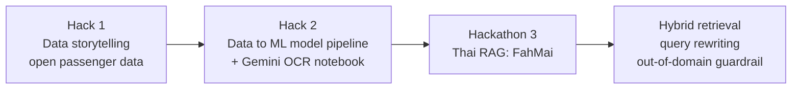

# Super AI Engineer Season 6: Level 1

**Coursework and hackathon notebooks from the Super AI Engineer Season 6 programme (AIAT).**

  -2ea44f?style=for-the-badge)

## Tech stack

  

## Programme path

## Contents

| Folder | What is inside |
|---|---|
| `Level1/Hack1` | Data-storytelling notebooks and passenger datasets |
| `Level1/Hack2` | ML pipeline tutorial notebooks, Gemini OCR notebook |
| `Level1/Hackathon3` | FahMai RAG notebooks and the presentation PDFs |

Video and slide presentation: [Google Drive folder](https://drive.google.com/drive/folders/154R4NKf8iRgBhEzeumxTupCY25fM_y5f?usp=sharing)

---

