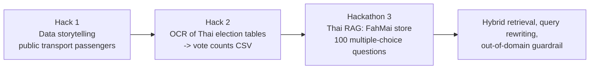
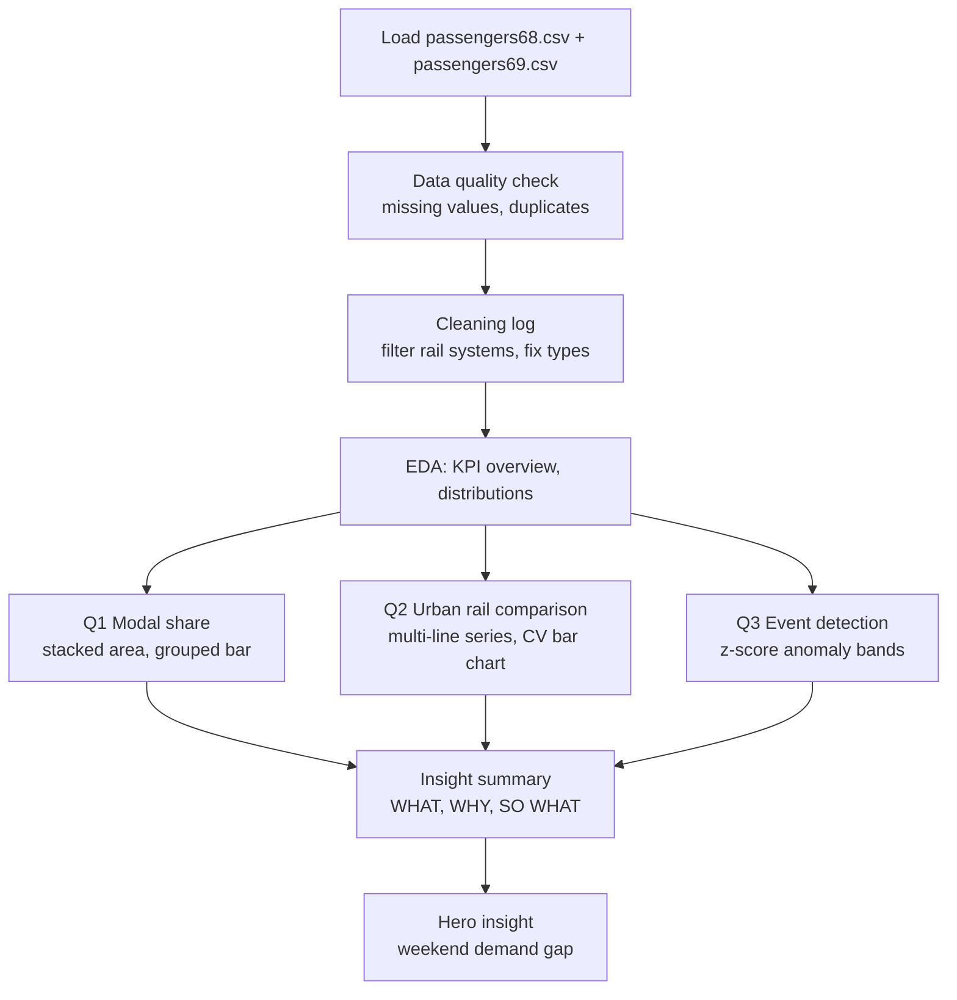
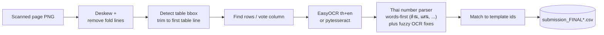
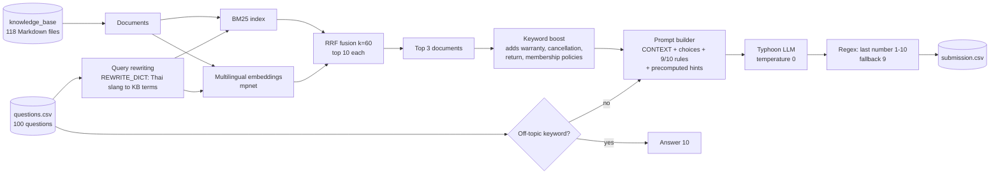
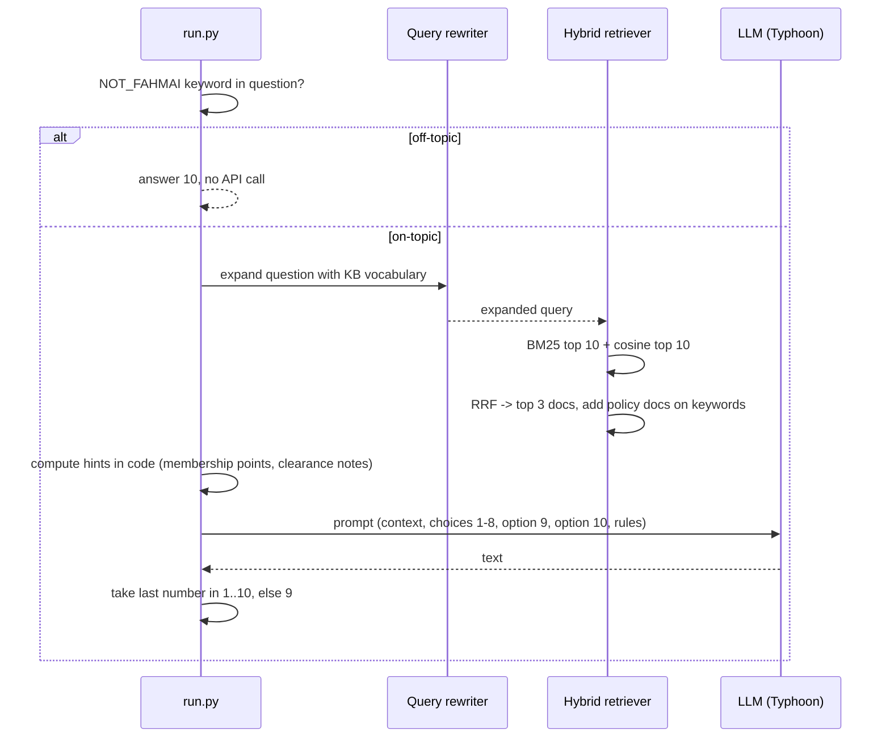

<div align="center">

# Super AI Engineer Season 6: Level 1

**Coursework and hackathon notebooks from the Super AI Engineer Season 6 programme (AIAT): data storytelling, Thai document OCR, and a Thai retrieval-augmented QA system.**

  -2ea44f?style=for-the-badge) 

</div>

> **Status: learning and competition archive, not a product.** The notebooks run on Google Colab with data on Google Drive; paths are hard-coded. The leaderboard score shown above is the author's own record from a Kaggle public leaderboard and was produced with a model that the author later flagged as outside the competition rules (see [Honest note on the 0.95 score](#honest-note-on-the-095-score)).

Last updated: 2026-11-03.

---

## Contents

- [Programme path](#programme-path)
- [Repository layout](#repository-layout)
- [Tech stack](#tech-stack)
- [Hack 1: Data storytelling](#hack-1-data-storytelling)
- [Hack 2: Thai election-form OCR](#hack-2-thai-election-form-ocr)
- [Hackathon 3: FahMai RAG](#hackathon-3-fahmai-rag)
- [How to run](#how-to-run)
- [Security notes and limitations](#security-notes-and-limitations)
- [Attribution](#attribution)
- [Presentation](#presentation)

## Programme path



## Repository layout

```
Super-AI-Ss6/
└── Level1/
    ├── Hack1/
    │   ├── 604328_Nattakamon_THackle.ipynb      Final mini-hackathon notebook (data to insight)
    │   ├── minihack.ipynb, Lecture3/            Working copies, lecture PDFs
    │   ├── dataset/passengers68.csv, passengers69.csv
    │   └── lecture1/, lecture2/                 Tutorials: Pandas EDA, visualisation, ML pipeline
    ├── Hack2/
    │   ├── final_data/Lastest_hack2_OCR.ipynb   Table detection + EasyOCR + Thai-number parser
    │   ├── final_data/images/                   Scanned election-result pages (PNG)
    │   ├── final_data/submission_template_v4.csv
    │   ├── sub_hack2.ipynb, sub_hack2__gemini_ocr2.ipynb   Experiments
    │   └── Tutorial_ From Data to Model Pipeline.../
    ├── Hackathon3/
    │   ├── fahmai_rag/
    │   │   ├── run.py                           Pipeline used for the 0.95 submission
    │   │   ├── chunk_builder.py, bm25_index.py, vector_index.py, retriever.py, llm_caller.py   Modular first version
    │   │   ├── create_silver_labels.py, gt_claude.txt   Silver labels from another LLM
    │   │   ├── fahmai_thalle.ipynb              Write-up, score history, THaLLE 8B variant
    │   │   ├── knowledge_base/                  110 product pages + 5 policies + 3 store-info pages (Markdown)
    │   │   ├── questions.csv, sample_submission.csv, submission*.csv, result/
    │   │   └── bm25_index.pkl, chroma_db/       Built indexes (committed)
    │   ├── FahMai_RAG_Hack_Presentation.pdf
    │   └── A_Crash_Course_for_Neural_NLP_using_Pretrained_LLMs.ipynb   Course material (third party)
    └── SuperAI6_Logo for Video/                 Programme logos
```

## Tech stack

| Area | Tools (from the code) |
|---|---|
| Notebooks | Jupyter, Google Colab, Google Drive |
| Data analysis | pandas, NumPy, matplotlib (Thai fonts: Garuda / Noto) |
| OCR | OpenCV (deskew, line removal, table bounding box), EasyOCR (`th`, `en`), pytesseract |
| Retrieval | `rank_bm25` (BM25Okapi), `sentence-transformers` (`paraphrase-multilingual-mpnet-base-v2`), ChromaDB (modular version), cosine similarity (`scikit-learn`) in `run.py`, Reciprocal Rank Fusion (k=60) |
| LLM | Typhoon via an OpenAI-compatible endpoint (`typhoon-v2.5-30b-a3b-instruct` in `run.py`, `typhoon-v2-70b-instruct` in `llm_caller.py`); THaLLE-0.2-ThaiLLM-8B-fa via `aift` in the notebook variant; Claude used only to create silver labels |
| Evaluation | Kaggle public leaderboard, self-made silver labels |

<p align="center">
  
</p>

---

## Hack 1: Data storytelling

Mini-hackathon "From Data to Insight" on Dataset 5, public-transport passenger statistics from the Ministry of Transport (two CSV files for the years 2568 and 2569 in the Buddhist calendar; see `Level1/Hack1/dataset`). The final notebook is `604328_Nattakamon_THackle.ipynb`.



Every cleaning step is written to a `cleaning_log`. The notebook states its headline numbers (for example the weekend demand gap and a revenue-loss estimate) in its own markdown cells; they are the author's analysis of the supplied data and are not re-verified here.

## Hack 2: Thai election-form OCR

Task (from the notebooks and the submission template): read vote counts from scanned Thai election result pages (`constituency_*` and `party_list_*` PNGs) and fill `submission_template_v4.csv`, whose rows are `id,votes` with ids like `constituency_10_1_1`.



The vote column contains numbers written both as digits and as Thai words. The parser converts Thai digits, interprets words with magnitude tables and applies a dictionary of known OCR confusions (for example several misreadings of the word for "four"). An "interactive vote editor" cell lets a human correct OCR output.

The file `sub_hack2__gemini_ocr2.ipynb` is named after Gemini; a keyword scan of its code cells found EasyOCR and pytesseract and no Gemini API call. I did not read every cell, so treat the name as historical.

## Hackathon 3: FahMai RAG

**Task.** Answer 100 multiple-choice questions (10 choices each) about FahMai, a fictional Thai electronics store, using only a supplied Markdown knowledge base. Choices 1-8 are content answers, choice 9 means "the store knowledge base has no such information", choice 10 means "the question is not about the store". Submission is a CSV `id,answer`. The competition rules quoted in the notebook require Thai LLMs only (OpenThaiGPT, Pathumma, Typhoon-S, THaLLE) and fully automatic answering.

### System architecture



### Question flow



### Design choices worth knowing

- **Chunking** (modular version `chunk_builder.py`): product pages are split at `##` headings with the file name prefixed; policy and store pages use a 400-word window with 80-word overlap. `run.py` instead retrieves whole documents (each context document is truncated to 9000 characters in the prompt).
- **Tokenisation:** BM25 splits on whitespace; the comments note that `pythainlp` could be added if accuracy is insufficient.
- **Numbers computed in code, not by the LLM:** membership points (price divided by 100, rounded down, times the tier multiplier) are precomputed and passed as a hint, which the author found necessary because the LLM miscalculated.
- **Abstention options:** choices 9 and 10 give the model an explicit "not in knowledge base" and "unrelated" exit, backed by a keyword list for obviously off-topic questions.
- **Silver labels:** `create_silver_labels.py` asks Claude to answer each question over the knowledge base and compares with the submission (`gt_claude.txt` holds the results) to find disagreements before submitting.

### Score history (author-recorded, from `fahmai_thalle.ipynb`)

| Version | Public LB | Main change |
|---|---|---|
| v1 | 0.61 | BM25 only |
| v2 | 0.75 | Add vector search + RRF |
| v3 | 0.82 | Contextual boost (policy files) |
| v4 | 0.86 | Query rewriting + off-topic detection |
| v5 | 0.88 | Fix wrong-file retrieval (CreatorBook, X9 Pro) |
| v6 | 0.91 | Special-case prompts (speaker, headphone, shipping) |
| v7 | 0.93 | Precomputed points + G5 clearance confusion fix |
| v8 | **0.95** | DDR4/DDR5 confusion fix + one headphone-count question |

Lessons the author recorded: retrieval was the main problem; LLMs miscalculate so precompute; context quality beats context quantity; silver labels help before submitting.

### Honest note on the 0.95 score

1. **Model rule.** The 0.95 pipeline (`run.py`) uses `typhoon-v2.5-30b-a3b-instruct`. In the notebook's first cell the author states that she re-read the rules at the deadline, realised only 8B-class Thai LLMs from the allowed list were permitted, asked the judges to deduct points accordingly, and built an 8B variant (THaLLE-0.2-ThaiLLM-8B-fa via `aift`) afterwards, which she could not submit because the daily submission limit was reached. No score is recorded for the 8B variant. Treat 0.95 as a score obtained under a rule violation that the author disclosed.
2. **Question-specific rules.** `run.py` and `result/run_078.py` contain hand-written special cases and hints tied to individual leaderboard questions (for example fixed totals and product lists inside prompts). This improves the public score but is overfitting to the known question set, not general retrieval quality; a fair evaluation would use held-out questions.
3. Scores are public leaderboard numbers, not the private leaderboard used for final ranking.

## How to run

These scripts were run on a laptop or Colab; there is no `requirements.txt`. The imports tell you what is needed.

```bash
cd Level1/Hackathon3/fahmai_rag
# run.py imports: pandas, numpy, openai, rank_bm25, sentence_transformers, scikit-learn
python run.py          # reads questions.csv and knowledge_base/, writes submission.csv
```

`run.py` calls a hosted Typhoon API and needs an API key; the current file holds a hard-coded key, which you should replace by an environment variable (see below) before running. Notebooks under `Hack1` and `Hack2` expect Colab and the Drive paths shown in their first cells.

No automated tests exist. Evaluation is the Kaggle public leaderboard plus Claude-generated silver labels.

## Security notes and limitations

- **Committed API key.** `Level1/Hackathon3/fahmai_rag/run.py` and `result/run_078.py` contain a hard-coded Typhoon API key (`TYPHOON_API_KEY = "..."`). It is in the git history, so deleting the line is not enough: revoke and rotate the key, then load the replacement from an environment variable. I have not reproduced the value here. `llm_caller.py` also sets an `api_key=` argument literally; I did not check whether it is a placeholder. `create_silver_labels.py` uses a placeholder string.
- **Pickle index.** `bm25_index.pkl` is a pickled object committed to the repository. Never `pickle.load` index files from untrusted sources; rebuild from the knowledge base instead.
- **Prompt injection.** Retrieved text is placed directly in the prompt. Here the knowledge base is trusted competition data; in a real deployment treat retrieved content as untrusted.
- **Data.** The FahMai knowledge base and questions are competition material (fictional store). The Hack 1 CSVs are open government data. Election-form images are public documents, but verify licensing before redistribution (ASSUMPTION).
- **Course material.** `A_Crash_Course_for_Neural_NLP_using_Pretrained_LLMs.ipynb` is third-party teaching material (see Attribution).

## Attribution

- Programme: Super AI Engineer Season 6, AIAT and partners (logos in `Level1/SuperAI6_Logo for Video/`).
- `A_Crash_Course_for_Neural_NLP_using_Pretrained_LLMs.ipynb`: compiled by Prachya Boonkwan, SIIT, Thammasat University (May 2023), per the notebook header. Not the author's work.
- Hack tutorials under `lecture1`, `lecture2` and `Hack2/Tutorial_...` are programme material.
- Author of the hack notebooks and the FahMai pipeline: Nattakamon Jaimetha (student id 604328 in the notebooks), GitHub [Dxrksvng](https://github.com/Dxrksvng).

## Presentation

Video and slide presentation: [Google Drive folder](https://drive.google.com/drive/folders/154R4NKf8iRgBhEzeumxTupCY25fM_y5f?usp=sharing). Slides are also in `Level1/Hackathon3/FahMai_RAG_Hack_Presentation.pdf`.
